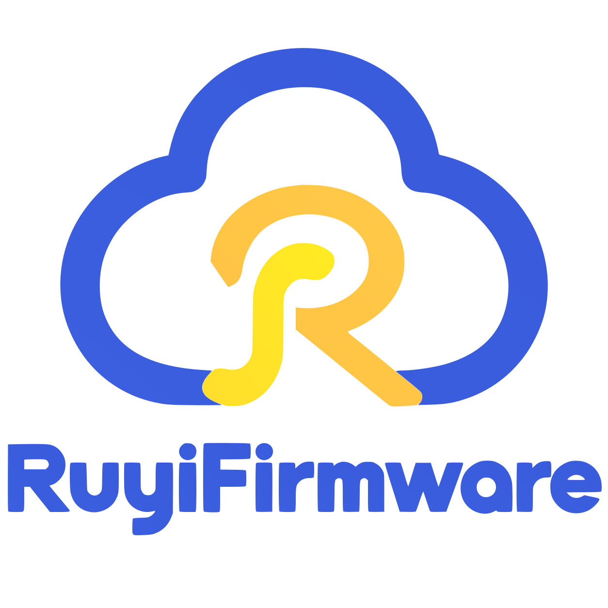

# Ruyi Firmware

RISC-V firmware with broad OS support and a focus on openRuyi.
The project uses open-source components wherever possible.

## Supported boards

Download the [release package](https://github.com/openRuyi-Project/ruyifirmware/releases)
for your board and follow its guide.

| SoC family | Board guides |
| --- | --- |
| [SpacemiT K3](https://www.spacemit.com/products/keystone/k3) | [SpacemiT K3 Pico-ITX](docs/k3/README.md) |
| [SiFive FU740](https://www.sifive.com/development-platforms/hifive-unmatched) | [SiFive HiFive Unmatched A00](docs/unmatched/README.md) |
| [ESWIN EIC7700](https://www.eswincomputing.com/en/bocupload/2024/06/19/17187920991529ene8q.pdf) | [SiFive HiFive Premier P550](docs/p550/README.md), [Milk-V Megrez](docs/megrez/README.md), [PINE64 StarPro64](docs/starpro64/README.md) |
| [SOPHGO SG2042](https://en.sophgo.com/sophon-u/product/introduce/sg2042.html) | [Milk-V Pioneer, SOPHGO EVB v1 and EVB v2](docs/sg2042/README.md) |
