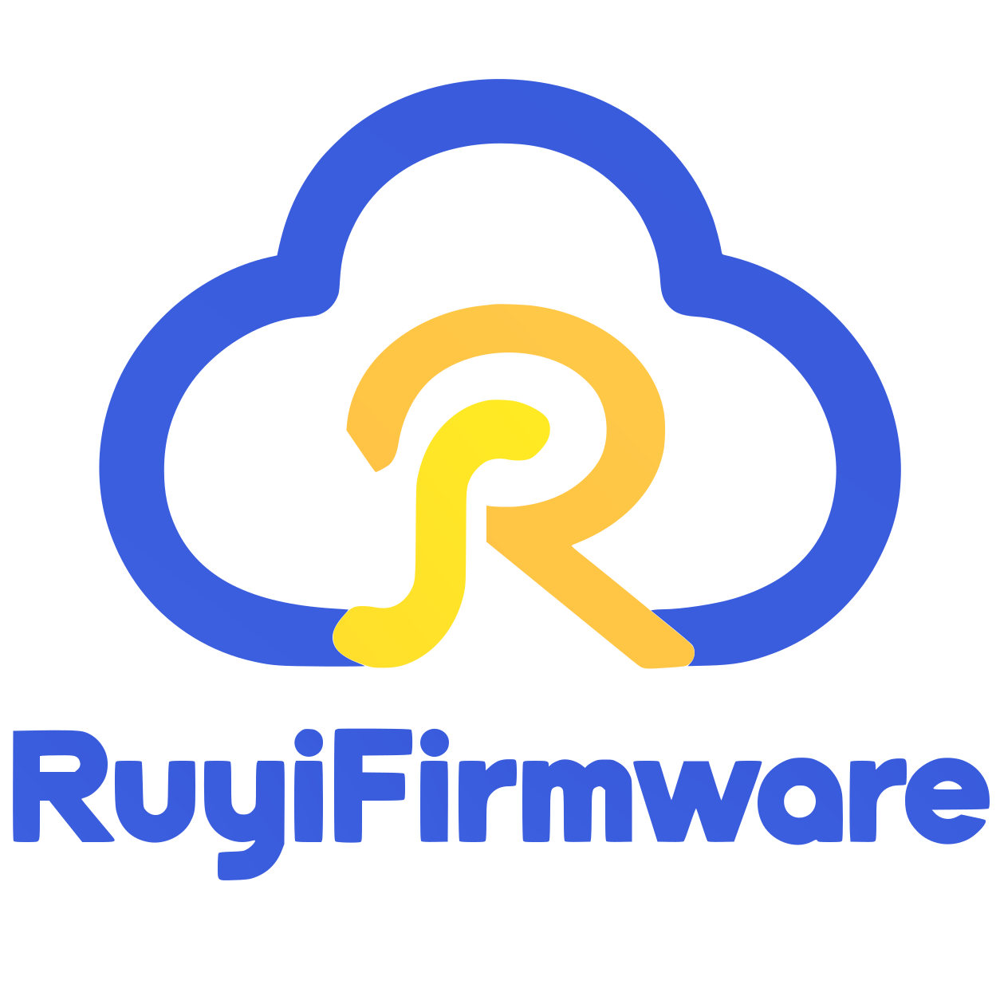

# Ruyi Firmware

RISC-V firmware with broad OS support and a focus on openRuyi.
The project uses open-source components wherever possible.

Download a [release package](https://github.com/openRuyi-Project/ruyifirmware/releases),
then follow the guide for your board:

- [SpacemiT K3](docs/k3/README.md)
- [SiFive HiFive Unmatched](docs/unmatched/README.md)
